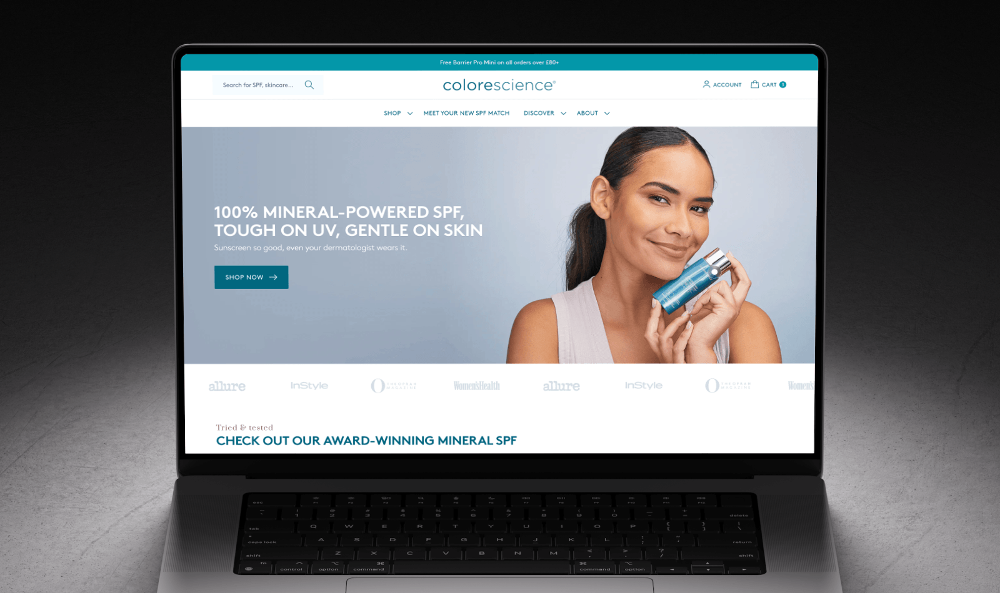

<!--
DRAFT — before un-hiding:
- [ ] Fill in the test #8 result section (read once, at the stop: first full week with ≥3,060 visitors per variant, hard stop 15 Nov)
- [ ] Clearance from work: naming the brand, and publishing the percentages and rates below. No £, AOV, revenue or traffic totals are in here (by design)
- [ ] Old mobile PDP load time: build_context.md says "up to 10 seconds", Alex said "5s+" in chat. Pick one, with how it was measured. Same for 0.5s and 9.1×
- [ ] Rebuild assets: before/after mobile PDP, one slice of the competitor feature-audit doc
- [ ] Meta spend growth as an index or multiple (e.g. "roughly 3×"), no £. Currently says "grew significantly"
- [ ] Confirm the override was actually ticked on the live theme (settings_data.json history, or replays of control users 5–12 Feb)
- [ ] USP C: say "reverted" only once it has shipped
- [ ] Confirm the brand URL (colorescience.co.uk is a guess)
- [ ] Delete build_context.md from this folder before publishing (or move it to _private/): it sits inside the content collection
- [ ] Charts (see CHART comments)
- Deliberately left out: unpublished reviews / DMCC, refused returns, £ figures, planning-doc projections, the brand being deprioritised internally, build details already covered in the Hydropeptide case study
-->

I run CRO and development for [Colorescience UK](https://colorescience.co.uk/), a premium mineral SPF brand. Over the past year, I helped the store take on <mark>82% more traffic without losing conversion</mark>: orders grew 78%, and CVR held steady.

Here's why that matters: most of the new traffic was paid social. Cold traffic like that usually drags conversion down, and on our product pages, Meta visitors add to cart at about a third of the rate of everyone else. Holding conversion through that growth meant the extra ad spend turned into orders.

What I did:

- **Rebuilt the store** in 2025: mobile product pages went from 5s+ to ~0.5s.
- **Fixed the reporting:** bots, seasonality and promotions were misleading the dashboard, in both directions.
- **Reset our A/B testing:** our first programme was too small to prove its results, so I rebuilt it around fewer, properly powered tests.
- **Found the next opportunity:** half of mobile visitors leave before seeing a price, mostly from Meta ads. A pre-registered test is now running against it.

***

## Business Context

Colorescience sells mineral sunscreen direct to consumers. A few things about the store shape everything below:

- **Mobile:** 94% of UK sessions.
- **Premium audience:** customer interviews put it at 75% women, mostly professionals buying into premium, lifestyle-led brands.
- **Seasonal:** autumn traffic is around 40% of July's, so month-on-month comparisons mislead, and tests take longer in autumn.
- **Shared resources:** it's one of several brands in our group, so development time is shared. That favours fewer, bigger changes.

***

## Part 1: The foundation

When we took on the UK store, it ran on an ageing off-the-shelf theme that had slowed with every update. Mobile product pages took <mark>more than 5 seconds to load</mark>.

I started out treating it as a normal CRO project: run tests, find wins. The research quickly showed that wouldn't work.
- **GA4:** most mobile visitors dropped off on product pages without scrolling or interacting.
- **Clarity session recordings:** pages loading slowly, then burying reviews and benefits under too much content.
- **Customer interviews (run by our UX designer):** we were competing with premium lifestyle brands, not bargain skincare.

You don't need an A/B test to tell you a page that takes 5 seconds to load is losing customers, so the rebuild became the CRO decision.

<!-- IMAGE: before/after mobile PDP -->

I built a competitor feature audit, breaking down how premium brands handled product pages, navigation and quick shopping, and used it to plan the new site with our UX designer. It was mobile-first throughout: swipeable carousels, thumb-friendly transactional navigation, and a quick-shop drawer. Then I built it on Dawn, launching in May 2025. In parallel, I worked with our SEO consultant to fix the technical SEO.

- Mobile product pages: <mark>5s+ → ~0.5s</mark>
- Site speed overall: <mark>9.1× faster</mark>

<!-- IMAGE: slice of the competitor feature audit -->

**What I don't credit the rebuild with:** a specific conversion lift. A ~16% price rise on best sellers landed in the same weeks, and Shopify's cart tracking was broken in the months around launch, so the effect of the rebuild can't be separated from the effect of the price. Its value shows up in what the store could handle next.

***

## Part 2: Scaling traffic without losing conversion

Over the following year, traffic grew a lot, and most of the growth was paid. Paid Search went from 3.5% to 20.4% of sessions, and Meta spend grew significantly.

Paid social is cold traffic: these people are scrolling Instagram, not searching for sunscreen. On our product pages, Meta visitors add to cart at 8%, against 26% for everyone else. Scale up a channel like that and you'd expect conversion to fall.

To check whether it did, I compared the same promotion-free summer days in both years, UK only:

| Same promotion-free days, UK (12–28 Jul + 12–23 Aug) | 2025 | 2026 |
| --- | --- | --- |
| Sessions | — | <mark>+82%</mark> |
| Purchases | — | <mark>+78%</mark> |
| Purchase rate (95% interval) | 5.83% (5.42–6.27) | 5.68% (5.37–6.00) |

<!-- CHART: matched-window sessions, purchases and purchase rate with intervals -->

Nearly double the traffic, nearly double the orders, and a conversion rate that held within its margin of error. Mobile basket → purchase actually improved, from 35.6% to 38.1%.

The averages hide some movement underneath, though. Organic and Direct conversion dipped, and the Meta gap turned out to be bigger than anyone could see at the time (more on that in Part 5). Getting to that level of detail meant fixing the numbers first.

***

## Part 3: Getting numbers you can trust

On a small, seasonal store, the standard dashboards were telling misleading stories in both directions. One month looked like a crash, another like a triumph.

The clearest example: comparing January with August 2026, conversion was up <mark>+71%</mark>. That looks like a huge result for the testing programme that started in January. But in 2024, with no testing programme at all, conversion rose 79% over the same months. January is when nobody buys sunscreen.

A few things like that were moving the conversion rate without the site changing at all.

### Seasonality

Month-on-month comparisons are close to meaningless here, so every comparison became year on year, on matched days.

<!-- CHART: conversion by month, 2024 vs 2026: the Jan→Aug rise happens every year -->

### Bot traffic

From mid-January 2026, monthly sessions swung between 9k and 49k while orders barely moved. When I broke Direct traffic down by country, device and landing page, the cause was clear. In April, ~91% of Direct sessions were non-UK desktop visits lasting 2–5 seconds, landing straight on SPF product pages: almost certainly a price scraper.

Bots add sessions but never buy. In April, the reported purchase rate was <mark>2.20% across all traffic, against 5.16% for real UK visitors</mark>. The bots also arrived in the same month testing began, which made January's starting point look artificially low.

<!-- CHART: Direct sessions vs purchases, Jan–Jul 2026 -->

### Promotions and spikes

Sales lift conversion while they run, and each one boosts specific channels and products. I rebuilt the promotion calendar for both years from order data and removed those days from every comparison. A podcast about the brand had the opposite effect: in January it sent organic traffic to about 4.5× December's level, and conversion dipped as curious first-time visitors browsed without buying.

### The rules that came out of it

- UK traffic only. That's who can buy, and it removes most of the bots.
- Same days year on year, never month to month.
- Promotion days removed, using dates from order data, not memory.
- Shopify, GA4 and PostHog checked against each other, with a 95% interval on every rate.

***

## Part 4: What our first year of testing could and couldn't tell us

From January to August 2026 we ran a six-test programme on top of the new theme, covering navigability, trust and price objections. Once the measurement was clean, I re-ran every test over its full period, UK only:

| Test | Full period, UK (95% interval) | Shipped? |
| --- | --- | --- |
| PDP Recently Viewed | +4.0% (−11% to +22%) | Yes |
| Card Badges | +6.8% (−10% to +27%) | Yes |
| PDP Badges | +5.5% (−15% to +31%) | Yes |
| PLP Recently Viewed | −5.6% (−27% to +21%) | No |
| PLP Badges | +4.5% (−16% to +30%) | No |
| USPs B / C / D / E | +0.7% / −5.6% / −6.4% / −8.0% | C |
| PDP Blocks | −2.5% (−14% to +11%) | No call |

<!-- CHART: every test's lift with its 95% interval, shipped tests marked -->

The three shipped tests all point upwards. Together, the shipped changes come out at a median of <mark>+11%, with a 73% chance of being positive</mark>. So they most likely helped. But every interval crosses zero, so none of them can be proven at this traffic.

That gap between "probably" and "provably" came down to three things, and each one changed how we test now:

- **The tests were too small for the effects they were looking for.** The plan expected 4–8% lifts. A two-week test on this traffic carries about ±16% of noise. **Now:** work out the smallest detectable lift before launch, and run fewer, bolder tests that can actually reach it.
- **Results were read while tests were still running.** Mid-test readings were consistently rosier than the full-period result (PDP Badges looked like +19.9%, and settled at +5.5%). In the USP test, variant C was shipped on AOV, chosen after the results were in, and its conversion was most likely lower than control. **Now:** one primary metric, chosen in advance, read once at a planned end date. I've recommended reverting C.
- **A QA switch reached the live site.** For about six weeks, a "turn on all tests" setting meant every visitor saw the test version, so two shipped tests most likely compared identical pages. **Now:** the harness was rebuilt in July so flags only load where their test appears. <!-- TODO: if shipped, add: eligibility off by default; QA override limited to the theme editor -->

***

## Part 5: Where mobile shoppers are actually lost

With trustworthy data, the useful question was where the next gain is. (The rebuild had fixed the speed problem behind 2025's product page drop-off. Part of that drop-off, it turned out, was still there.) I fixed the method before pulling the data: compare each funnel step against the best comparable segment, on clean days, with minimum sample sizes. The biggest gap was <mark>mobile product page → add to cart</mark>: 20.3% on mobile against 29.6% on desktop.

### Half of visitors leave before they see a price

I wrote SQL against raw PostHog events for the best-selling product, a tinted SPF, to see how far each visitor scrolled and whether they added to cart. On a standard iPhone, the first screen shows the gallery, badges, rating and title. Price, shades and Add to Cart are just below it.

| Deepest point reached | Share of visitors | Added to cart |
| --- | --- | --- |
| First screen only | ~48% | 2–5% |
| Price and swatches | 6% | 11% |
| Just past Add to Cart | 12% | 42% |
| Details, reviews and below | 33% | 37–38% |

<!-- CHART: scroll reach down the page with price, swatches, reviews marked; ATC by depth -->

Visitors who scroll convert well. The loss is the half who leave from the first screen without ever seeing a price. The shade picker, my main suspect, wasn't the problem: visitors who compared several shades added to cart at the same rate as those who clicked one.

### And most of them come from Meta

| Source (mobile UK visitors) | Share of visitors | Left from first screen | Added to cart |
| --- | --- | --- | --- |
| Meta ads | 39% | 73% | 8.1% |
| Everything else | 61% | 34% | 26.2% |

<!-- CHART: first-screen exits and ATC, Meta vs other -->

This is the cost of scaling paid social: people tap a fairly generic ad and land on a product page built for someone who searched for the product.

It hadn't shown up sooner because the ads were mis-tagged (`utm_source` and `utm_medium` swapped). GA4 most likely filed them under "Unassigned", so <mark>the fastest-growing traffic source was invisible in channel reports</mark>. <!-- TODO: once done, add "I passed the tagging fix and the conversion data to the paid media team." -->

### Reviews put the shade problem after purchase

I also analysed all 1,221 UK reviews. Shade was the top complaint, but combined with the behavioural data it shows up *after* purchase, not before: people choose a shade blind, get it wrong and leave a 1-star review.

So shade gets fixed rather than tested. That means correcting the site's "size down if between shades" advice, which reviewers quote as the reason they bought the wrong one, and setting expectations about how the product goes on.

***

## Part 6: The next test

Everything above points at one change: **put the buying decision on the first screen.** I designed it as a "decision-first" mobile product page, with a compact gallery and the title, price, shade swatches and Add to Cart all visible without scrolling. It reorders existing content, so it needs no new copy, and it covers every mobile product page.

It's built to give a result that holds up, and the pre-registration was committed to git before launch:

- **Primary metric:** the share of visitors who add to cart. Purchases and revenue per visitor are guardrails.
- **Smallest detectable lift:** +15% at 80% power. That's 3,060 visitors per variant, about 5–6 weeks in autumn.
- **One read** at the planned stop, with a hard stop before Black Friday.
- **Ship rule:** the whole 95% interval sits above zero, and no guardrail blocks.
- **Meta vs everyone else** is read as a segment chosen in advance.
- **A daily split check** for the first three days, plus anti-flicker applied equally to both variants.

<!-- TODO: RESULT — read once at the stop. Split check, add-to-cart lift with 95% interval, guardrails, Meta segment, decision. Report it straight whichever way it goes. -->

### Result

*Test running. Result to follow, read once at the planned stop.*

***

## Key Learnings

**Scaling is a conversion result too.** Holding conversion while traffic nearly doubles, much of it cold, doesn't make a flashy headline, but it's what lets growth turn into orders. A fast foundation is what made it possible.

**On a small, seasonal store, measurement comes before optimisation.** Bots, seasonality and promotions can each move conversion more than any test. Sorting those out first is what made everything after it readable.

**Size tests to the traffic you actually have.** Fewer, bolder changes, with the detectable lift worked out before launch and one planned read, beat a steady stream of small tests nobody can prove.

**Break problems down by traffic source.** The biggest product page problem turned out to be one channel landing in the wrong place, and it had been hidden by a tagging mistake.
