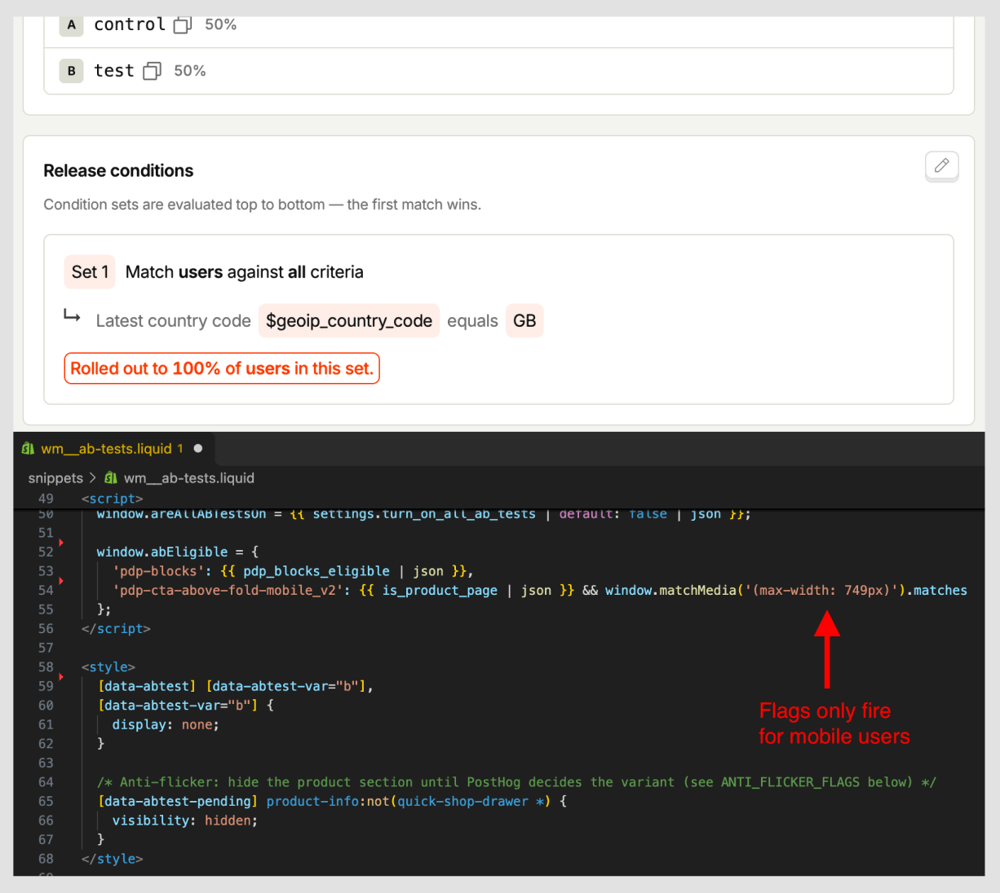

import BeforeAfter from '@/components/ui/BeforeAfter.astro'
import homeBefore from './_assets/cs-before.jpg'
import homeAfter from './_assets/cs-after.jpg'
import pdpBefore from './_assets/cs-pdp-before-mob.jpg'
import pdpAfter from './_assets/cs-pdp-after-mob.jpg'

I run CRO and development for [Colorescience UK](https://colorescienceuk.com/), a premium mineral SPF brand. Over the last 12 months, my rebuild and CRO work helped lift conversion <mark>27%</mark> above the 12 months before it began. Alongside scaling paid ads, that grew revenue by <mark>£237K year on year</mark>.

After seven weeks of testing, UK conversion reached <mark>6.04% in October</mark>, against [INSERT NUMBER: UK CVR October 2025, same bot/promo filtering] a year earlier ([CALCULATION: 6.04% ÷ October 2025 UK CVR − 1]) - out of season!

Getting there meant admitting the tests I'd been crediting hadn't actually proven anything, and rebuilding how we measure and test.


***

## Context

Colorescience sells mineral sunscreen direct to consumers. It's premium, 94% of UK sessions are mobile, and it's very seasonal: autumn traffic is around 40% of July's.

In 2025 I rebuilt the store, moving it from an ageing off-the-shelf theme to a custom Dawn build, after research showed that speed and an overloaded mobile product page were the main problems. Mobile product pages went from <mark>5s+ to ~0.5s</mark> [INSERT NUMBER: name the measure, e.g. p75 LCP], and the site overall is 9.1× faster [INSERT NUMBER: same, which measure].

(Really not exaggerating here, it was *crushingly* slow…)

<BeforeAfter
  before={homeBefore}
  after={homeAfter}
  beforeLabel="Before"
  afterLabel="After"
  alt="Colorescience UK homepage after the Dawn rebuild"
/>

<BeforeAfter
  before={pdpBefore}
  after={pdpAfter}
  beforeLabel="Before"
  afterLabel="After"
  alt="Colorescience UK mobile product page after the Dawn rebuild"
  maxWidth="280px"
/>

A ~16% price rise landed in the same weeks, so I don't credit the rebuild with a specific conversion lift. But everything below sits on it.

***

## What I got wrong: the numbers

By August, conversion rate was up 71% since January, and I was crediting the A/B testing programme I'd been running…

I'd been reading it the way most in-house teams do: this month against last. On a sunscreen brand. From January to August. (Yes, that ~~dumb~~ myopic.)

Three things were driving that +71%, and none of them had anything to do with the site:

- **Seasonality.** In 2024, with no testing at all, conversion rose 79% over the same months. *(Duh-doy…)*
- **Bots.** From mid-January, a scraper wave hit Direct traffic. By April, bots were ~91% of Direct sessions ([INSERT NUMBER: bots as % of all sessions in April]), and the all-traffic purchase rate was 2.20% against 5.16% for real UK visitors.
- **Promotions and spikes.** There were three major discount periods over summer, and in January a podcast sent organic traffic to 4.5× December's level.

With those stripped out, I compared the same promotion-free days in 2025 and 2026 (12–28 July and 12–23 August), UK only:

- Sessions were up 82%, and purchases were up 78%.
- The purchase rate went from 5.83% to 5.68%, well within each other's 95% intervals. <mark>Conversion rate held as we scaled paid ads.</mark>

{/* CHART: matched-window sessions, purchases and purchase rate with intervals */}

That's better than it sounds. Most of the growth came from paid ads: Meta went from [INSERT NUMBER: Meta % of UK sessions, 2025 window] to [INSERT NUMBER: Meta % of UK sessions, 2026 window] of UK sessions, and Meta visitors add to cart at about a third of everyone else's rate ([INSERT NUMBER: Meta ATC rate] vs [INSERT NUMBER: non-Meta ATC rate]). Conversion held anyway.

## What I got wrong: the tests

From January to August, I'd been running tests on PostHog and shipping variants once they had a 75–85% probability of beating control. When I re-ran all [INSERT NUMBER: tests run January–August] of them over their full periods, UK only, none could be proven: every 95% interval crossed zero.


The three I shipped did all point upwards, and together they most likely helped (a 73% chance). But "most likely" wasn't what I'd been reporting.

{/* CHART: every test's lift with its 95% interval, shipped tests marked */}

There were three reasons:

- **Too little traffic:** the tests aimed for 4–8% lifts, but two weeks here carries about ±16% noise.
- **Early reads:** PDP Badges looked like +19.9% mid-test, then settled at +5.5%.
- **Uneven splits:** the first three tests put up to 54% of visitors in the test variant, a sign the setup was broken.

## How I fixed it

- **UK visitors only,** set when a visitor is assigned a variant.
- **Like-for-like comparisons:** the same days year on year, with promotion days removed.
- **No single source of truth:** Shopify, GA4 and PostHog checked against each other.
- **Decide before launch:** one primary metric, a ship threshold and a fixed end date, read once after a split check.
- **Primary metrics close to the change:** add to cart happens about [CALCULATION: UK ATC rate ÷ UK purchase rate]× as often as a purchase, so two weeks of traffic carries about ±[INSERT NUMBER: two-week noise on ATC]% noise instead of ±16%.
- **Fewer, bolder tests,** sized to the traffic we actually have.

I also relabelled the two badge tests as untested features, and recommended reverting a USP variant that had shipped on a metric chosen after the results came in.



## What clean data showed

With numbers I could trust, the biggest gap in the funnel was <mark>mobile product page → add to cart</mark>: 20.3% on mobile against 29.6% on desktop.

On the best-selling product, a standard iPhone showed the gallery, rating and title on the first screen, with the price and Add to Cart just below. Nearly half of visitors (48%) never scrolled past that first screen, and only 2–5% of them added to cart. Of those who scrolled past Add to Cart, 42% added.

Most of those first-screen exits came from Meta ads: 73% of Meta visitors left there, against 34% of everyone else.

{/* CHART: ATC by scroll depth; first-screen exits, Meta vs other */}

Instead of a list of ideas to try, the clean data pointed to one step, on one device, driven by one audience. That made the first test obvious: put the price, shades and Add to Cart on the first screen, where most Meta visitors decide whether to stay.

***

## Seven weeks, four tests

- **Weeks 1–2:** a decision-first mobile product page (shipped), alongside an email test of 15% off vs a free gift (gift kept)
- **Weeks 3–5:** Quick Shop on collection pages, all devices (shipped)
- **Weeks 6–7:** a bundle on the mobile product page (not shipped)

All four followed the new rules. I ship when the primary metric has at least a 90% chance of beating control and no guardrail is clearly worse.

### 1. Decision-first product page (weeks 1–2)

The change: on mobile, the title, price, shade swatches and Add to Cart all sit on the first screen. It reorders existing content across every mobile product page, so it needs no new copy.

I also removed the quantity selector. Quantity can already be changed in the cart drawer, and for a cold audience arriving from a Meta ad, every control before the button is friction. Getting the first purchase mattered more than selling multiples.


Enrolment was deliberately tight. The PostHog flag only releases to UK visitors, and the theme only asks for it on mobile-width product pages, so desktop visitors who'd never see a difference can't dilute the result.

5,350 UK mobile visitors over two weeks:

- **Add to cart (primary):** 21.47% → 23.10%, <mark>+7.6%, with a 92.4% chance of beating control</mark>
- **Conversion:** 13.08% → 13.80%, +5.5% (78% chance)
- **Average order value:** £59.40 → £58.70, −1.2% (43% chance)

Add to cart cleared the bar, and conversion points the same way without being proven on its own. Dropping the quantity selector barely moved AOV. Putting the decision on the first screen fixed the largest gap the funnel analysis found, so it shipped.

### 2. 15% off vs a free gift (weeks 1–2)

Marketing relied heavily on discounts and gifts. I've never loved leaning on price for a premium brand. Constant offers just don't feel right for a product people should want at full price. But since offers were going out anyway, it was worth finding out which one costs less.

**Hypothesis:** a 15% discount would convert enough better than a free deluxe sample (on orders over £60) to make more money overall.

**Primary metric: margin per recipient.** That's total margin from a bucket's orders divided by the number of people emailed in that bucket.

- **Why margin:** conversion, revenue per visitor and AOV all ignore the cost of the offer, so they can point the wrong way.
- **Why per recipient:** PostHog only sees people who click through, and the two emails attract different people. Dividing by everyone emailed keeps the comparison randomised.

**How it worked:**


- The Klaviyo list was split randomly into two buckets, with the bucket saved on each profile.
- Each bucket's email linked to its own landing page. The pages were identical apart from the offer, unlisted and set to noindex.
- On load, the page records the bucket with `posthog.register({ offer_bucket })`, so it's attached to every later event, and applies that bucket's code. Each code works once per customer, and the two can't combine.
- In the gift bucket, the cart script reads the bucket and adds the gift when the cart reaches £60, then removes it if the cart drops below (much harder to get right than it sounds, but too long to cover here).

**Margin without per-order cost data.** If margin depends only on revenue and which offer the order actually used, a few formulas cover it. With *m* as average gross margin at full price (50%), *R* as revenue ex-VAT and shipping, and *G* as the gift's cost (£4):

- **Order used the 15% code:** R × (1 − (1 − m) ÷ 0.85) = 0.412 × R
- **Order included the gift:** m × R − G = 0.50 × R − £4
- **Order used neither:** m × R

The checkout pixel picks the formula from the order itself, not from the user's bucket. That way, someone in the 15% bucket who buys without the code is correctly given full-price margin:

```js
analytics.subscribe('checkout_completed', (event) => {
  const c = event.data.checkout;
  const codes = (c.discountApplications || [])
    .filter(d => d.type === 'DISCOUNT_CODE')
    .map(d => d.title.toUpperCase());

  const hasPct  = codes.includes('TEST15');
  const hasGift = c.lineItems.some(l => String(l.variant?.id).endsWith(GIFT_VARIANT_ID));

  const R = c.totalPrice.amount - c.totalTax.amount - (c.shippingLine?.price.amount || 0);
  const m = 0.50, G = 4;

  const margin = hasPct ? R * (1 - (1 - m) / 0.85)
                        : m * R - (hasGift ? G : 0);

  posthog.capture('purchase', { revenue: R, margin, pct_used: hasPct, gift_used: hasGift });
});
```

Custom pixels run in a sandbox, so the pixel reads the PostHog ID from its cookie and initialises PostHog with it. Otherwise, purchases wouldn't carry the bucket.

40,000 UK recipients, 14 days after the send:

- **Margin per recipient (primary):** £0.45 for the gift vs £0.42 for 15% off, so <mark>the discount made 7.1% less margin</mark> (24% chance it's actually better)
- **Conversion:** 1.80% → 2.00%, +11.1% for the discount (93% chance)
- **Revenue per recipient:** £1.19 → £1.23, +3.0% (62% chance)

The discount wins clearly on conversion and slightly on revenue, but it loses on margin. On conversion or revenue alone, marketing would have shipped it. On margin, the gift is probably the better offer (a 76% chance). That's short of my 90% bar, but with nothing to say the discount earns more, the cheaper, more on-brand offer stayed.

### 3. Quick Shop (weeks 3–5)

The change: Quick Shop buttons are always visible on mobile product cards. On desktop, they appear on hover with a short animation to draw attention. Control had hover-only Quick Shop on desktop and none on mobile.


I ran it across all devices to get a big enough sample. 20,000 UK visitors over three weeks:

- **Product view rate, page or drawer (primary):** 46.0% → 47.4%, <mark>+3.0%, with a 97.6% chance of beating control</mark>
- **Add to cart:** 15.20% → 15.95%, +4.9% (92.8% chance)
- **Conversion:** 9.10% → 9.38%, +3.1% (75.3% chance)

Big enough to confirm the engagement effect, but not the conversion effect: there's still roughly a 1 in 4 chance the conversion lift is zero or negative.


Two traps came out of this one:

- **Compare variants, not clickers.** People who open Quick Shop were more likely to buy anyway, so comparing them with non-clickers exaggerates the effect.
- **Check for substitution.** If people open the drawer *instead of* the product page, they've just taken a different route. I should have checked whether product page views fell as drawer opens rose, and I didn't.

### 4. Bundle on the product page (weeks 6–7)

I was against this test. Our CMO pushed for it because kit sales from ads were up 180% year on year, and expected bundles to lift AOV and customer lifetime value. But the decision-first page had just won by moving Add to Cart *up*, and a bundle module above the button moves it back down and adds a decision before the visitor can buy. I expected it to hurt.

Control was the decision-first page that had just shipped. 8,000 UK mobile visitors over two weeks:

- **Add to cart (primary):** 23.10% → 22.13%, <mark>−4.2%, with only a 15% chance of beating control</mark>
- **Average order value:** £58.70 → £59.60, +1.5% (60.6% chance)
- **Revenue per visitor:** −4.1% (30.7% chance)

AOV ticked up, but nowhere near enough to cover the lost add-to-carts. As expected, pushing the button down and adding a decision hurt. It didn't ship.

***

## Where it landed

UK conversion reached <mark>6.04% in October</mark>, out of season for a sunscreen brand, against [INSERT NUMBER: UK CVR October 2025, same filtering] a year earlier and [INSERT NUMBER: UK CVR in the two weeks before test 1] just before the tests began. Marketing ran strong campaigns over the same weeks, so not all of it belongs to the tests, but the decision-first page and Quick Shop both moved the funnel steps they were aimed at.

Over a full year, which seasonality can't flatter, human-only conversion from October 2025 to October 2026 was <mark>27% higher</mark> than from October 2023 to October 2024, before the rebuild or any testing.

***

## Looking back

Mismeasuring didn't make the first eight months a failure. The rebuild and early tests kept conversion steady while paid ads nearly doubled traffic with visitors far less ready to buy, and that's worth a lot on its own. What I couldn't do was prove it, or see where to go next.

The measurable wins came once I could trust the numbers. Clean data pointed to one specific problem, each test was built to answer a question rather than produce a number, and I could stand behind every result, including the two that said no.
