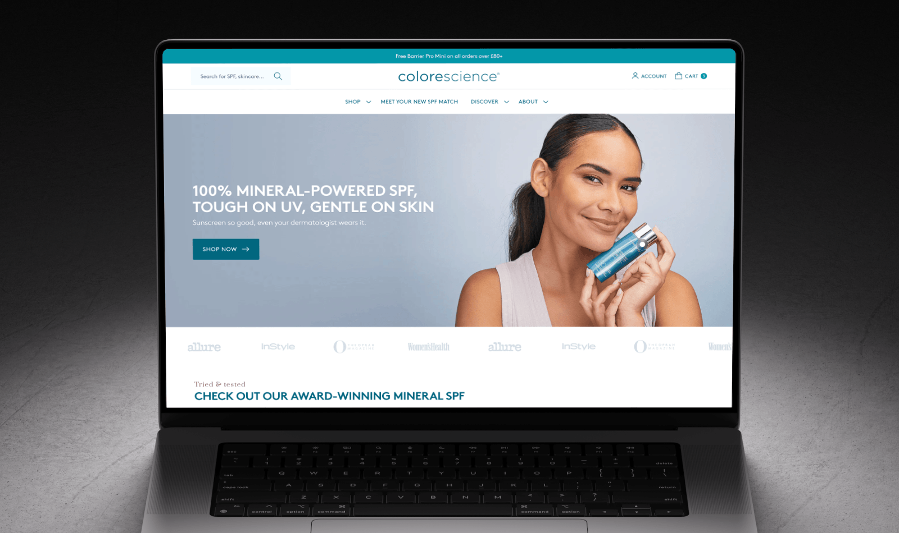
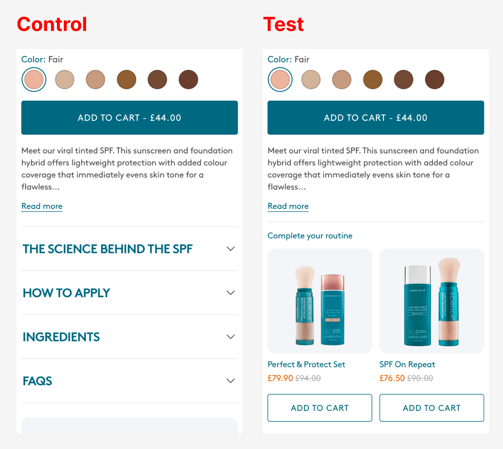

import BeforeAfter from '@/components/ui/BeforeAfter.astro'
import homeBefore from './_assets/cs-before.jpg'
import homeAfter from './_assets/cs-after.jpg'
import pdpBefore from './_assets/cs-pdp-before-mob.jpg'
import pdpAfter from './_assets/cs-pdp-after-mob.jpg'

I run CRO and development for [Colorescience UK](https://colorescienceuk.com/), a premium mineral SPF brand. Over the last 12 months, a rebuild I spearheaded followed by CRO work helped lift conversions <mark>+27%</mark>. Alongside scaling paid ads, that grew revenue by <mark>£237K year on year</mark>.

After seven weeks of testing, UK conversion reached <mark>6.04% in October</mark>, against 4.90% a year earlier (+23%) - out of season!

Getting there meant admitting the tests I'd been crediting hadn't actually proven anything, and rebuilding how we measure and test.



***

## Context

Colorescience sells mineral sunscreen direct to consumers. It's premium, 94% of UK sessions are mobile, and it's very seasonal: autumn traffic is around 40% of July's.

In 2025 I rebuilt the store, moving it from an ageing off-the-shelf theme to a custom Dawn build, after my research showed that speed and an overloaded mobile product page were the main problems. Mobile product pages went from <mark>5s+ to ~0.5s</mark> to load (p75 LCP), and the site overall loads 9.1× faster.

<BeforeAfter
  before={homeBefore}
  after={homeAfter}
  beforeLabel="Before"
  afterLabel="After"
  alt="Colorescience UK homepage after the Dawn rebuild"
/>

<BeforeAfter
  before={pdpBefore}
  after={pdpAfter}
  beforeLabel="Before"
  afterLabel="After"
  alt="Colorescience UK mobile product page after the Dawn rebuild"
  maxWidth="280px"
/>

A ~16% price rise landed in the same weeks, so I don't credit the rebuild with a specific conversion lift. But everything below sits on it.

***

## What I got wrong: the numbers

By August, conversion was up 71% since January, and I was crediting my A/B tests. But I was comparing this month with last, on a sunscreen brand. Three things that had nothing to do with the site explained it:

- **Seasonality:** in 2024, with no testing at all, conversion rose 79% over the same months.
- **Bots:** a scraper wave from January made up ~57% of sessions by April, pulling the measured purchase rate down to 2.20% (real UK visitors: 5.16%).
- **Promotions and spikes:** three summer sales, and a podcast that sent organic traffic to 4.5× December's level.

{/* CHART: monthly CVR Jan–Aug, 2024 vs 2026 – lines climbing together */}

So what did the rebuild and early tests actually do?

On the same promotion-free days in 2025 and 2026, UK only, sessions rose 82% and the purchase rate barely moved (5.83% → 5.68%, within noise). <mark>Conversion held while paid ads nearly doubled traffic</mark>, even though Meta's share of sessions went from 28% to 52% and Meta visitors add to cart at a third of everyone else's rate.

## What I got wrong: the tests

From January to August, I'd been running tests on PostHog and shipping variants once they had a 75–85% probability of beating control. When I re-checked all seven of them, none could be proven: every 95% interval crossed zero.


The three I shipped did all point upwards, and together they most likely helped (a 73% chance). But "most likely" wasn't what I'd been reporting.

{/* CHART: every test's lift with its 95% interval, shipped tests marked */}

- **Too little traffic:** the tests aimed for 4–8% lifts, but two weeks here carries about ±16% noise.
- **Early reads:** PDP Badges looked like +19.9% mid-test, then settled at +5.5%.
- **Uneven splits:** the first three tests put up to 54% of visitors in the test variant, a sign the setup was broken.

## How I fixed it

- **UK visitors only,** set when a visitor is assigned a variant.
- **Like-for-like comparisons:** the same days year on year, with promotion days removed.
- **No single source of truth:** Shopify, GA4 and PostHog checked against each other.
- **Decide before launch:** one primary metric, a ship threshold and a fixed end date, read once after a split check.
- **Primary metrics close to the change:** add to cart happens about 2.3× as often as a purchase, so two weeks of traffic carries about ±10% noise instead of ±16%.
- **Fewer, bolder tests,** sized to the traffic we actually have.

I also relabelled our previous winners as "inconclusive".


## What clean data showed

With numbers I could trust, the biggest gap in the funnel was <mark>mobile product page → add to cart</mark>: 20.3% on mobile against 29.6% on desktop.

On the best-selling product, a standard iPhone showed the gallery, rating and title on the first screen, with the price and Add to Cart just below. Nearly half of visitors (48%) never scrolled past that first screen, and only 2–5% of them added to cart. Of those who scrolled past Add to Cart, 42% added.

Most of those first-screen exits came from Meta ads: 73% of Meta visitors left there, against 34% of everyone else.

{/* CHART: ATC by scroll depth; first-screen exits, Meta vs other */}

Instead of a list of ideas to try, the clean data pointed to one step, on one device, driven by one audience. That made the first test obvious: put the price, shades and Add to Cart on the first screen, where most Meta visitors decide whether to stay.

***

## Seven weeks, four tests

- **Weeks 1–2:** a decision-first mobile product page (shipped), alongside an email test of 15% off vs a free gift (gift kept)
- **Weeks 3–5:** Quick Shop on collection pages, all devices (shipped)
- **Weeks 6–7:** a bundle on the mobile product page (not shipped)

All four followed the new rules. I ship when the primary metric has at least a 90% chance of beating control and no guardrail is clearly worse.

### 1. Decision-first product page (weeks 1–2)

The change: on mobile, the title, price, shade swatches and Add to Cart all sit on the first screen. It reorders existing content across every mobile product page, so it needs no new copy.

I also removed the quantity selector. Quantity can already be changed in the cart drawer, and for a cold audience arriving from a Meta ad, every control before the button is friction. Getting the first purchase mattered more than selling multiples.


Enrolment was deliberately tight. The PostHog flag only releases to UK visitors, and the theme only asks for it on mobile-width product pages, so desktop visitors who'd never see a difference can't dilute the result.

5,350 UK mobile visitors over two weeks:

- **Add to cart (primary):** 21.47% → 23.10%, <mark>+7.6%, with a 92.4% chance of beating control</mark>
- **Conversion:** 13.08% → 13.80%, +5.5% (78% chance)
- **Average order value:** £59.40 → £58.70, −1.2% (43% chance)

Add to cart cleared the bar, and conversion points the same way without being proven on its own. Dropping the quantity selector barely moved AOV. Putting the decision on the first screen fixed the largest gap the funnel analysis found, so it shipped.

### 2. 15% off vs a free gift (weeks 1–2)

Marketing leaned heavily on promos (something I'm not a fan of), so I tested which one costs less: 15% off, or a free deluxe sample on orders over £60.

**Why test at all?** Product data tells you what each offer costs per order, but not how people respond: how many extra buyers 15% off brings in, how many would have paid full price anyway, and how many push their basket past £60 for the gift. Across a large range at different prices, that's impossible to plan on paper, so the only way to know was to run both.

**Primary metric: margin per recipient.** Conversion and AOV ignore what the offer costs, and dividing by everyone emailed (not just clickers) keeps the comparison randomised.


I split the list in Klaviyo rather than on-site, so people were randomised before anyone clicked, and PostHog only had to carry each recipient's bucket through to purchase. With no per-order cost data, the checkout pixel estimates margin from what each order actually used, so a 15% recipient who buys without the code still counts at full margin:

```js
analytics.subscribe('checkout_completed', (event) => {
  const c = event.data.checkout;
  const codes = (c.discountApplications || [])
    .filter(d => d.type === 'DISCOUNT_CODE')
    .map(d => d.title.toUpperCase());

  const hasPct  = codes.includes('TEST15');
  const hasGift = c.lineItems.some(l => String(l.variant?.id).endsWith(GIFT_VARIANT_ID));

  const R = c.totalPrice.amount - c.totalTax.amount - (c.shippingLine?.price.amount || 0);
  const m = 0.50, G = 4;

  const margin = hasPct ? R * (1 - (1 - m) / 0.85)
                        : m * R - (hasGift ? G : 0);

  posthog.capture('purchase', { revenue: R, margin, pct_used: hasPct, gift_used: hasGift });
});
```

40,000 UK recipients, 14 days:

- **Margin per recipient (primary):** £0.45 for the gift vs £0.42 for 15% off, so <mark>the discount made 6.7% less margin</mark> (24% chance it's actually better)
- **Conversion:** 1.80% → 2.00%, +11.1% for the discount (93% chance)
- **Revenue per recipient (inc. VAT):** £1.19 → £1.23, +3.0% (62% chance)

On conversion or revenue alone, marketing would have shipped the discount. On margin, the gift is probably better (76% chance). That's short of my 90% bar, but with nothing suggesting the discount earns more, the cheaper, more on-brand offer stayed.

### 3. Quick Shop (weeks 3–5)

The change: Quick Shop buttons are always visible on mobile product cards. On desktop, they appear on hover with a short animation to draw attention. Control had hover-only Quick Shop on desktop and none on mobile.


I ran it across all devices to get a big enough sample. 20,000 UK visitors over three weeks:

- **Product view rate, page or drawer (primary):** 46.0% → 47.4%, <mark>+3.0%, with a 97.6% chance of beating control</mark>
- **Add to cart:** 15.20% → 15.95%, +4.9% (92.8% chance)
- **Conversion:** 9.10% → 9.38%, +3.1% (75.3% chance)

Big enough to confirm the engagement effect, but not the conversion effect: there's still roughly a 1 in 4 chance the conversion lift is zero or negative.


Two traps came out of this one:

- **Compare variants, not clickers.** Quick Shop users were likelier to buy anyway, so clicker vs non-clicker exaggerates the effect.
- **Check for substitution.** Drawer opens may have replaced product page views rather than added to them. I didn't check, which matters most for reading add to cart.

### 4. Bundle on the product page (weeks 6–7)

I was against this test. Our CMO pushed for it because kit sales from ads were up 180% year on year, and expected bundles to lift AOV and customer lifetime value. But the decision-first page had just won by clearing the path to Add to Cart, and a kit module right under the button adds a second decision, with two more Add to Cart buttons competing for the same tap. I expected it to hurt.



Control was the decision-first page that had just shipped. 8,000 UK mobile visitors over two weeks:

- **Add to cart (primary):** 23.10% → 22.13%, <mark>−4.2%, with only a 15% chance of beating control</mark>
- **Average order value:** £58.70 → £59.60, +1.5% (60.6% chance)
- **Revenue per visitor:** −4.1% (30.7% chance)

AOV ticked up, but nowhere near enough to cover the lost add-to-carts. As expected, adding a second decision straight after the first hurt. It didn't ship.

***

## Where it landed

UK conversion reached <mark>6.04% in October</mark>, out of season for a sunscreen brand, against 4.90% a year earlier and 5.52% just before the tests began. Marketing ran strong campaigns over the same weeks, so not all of it belongs to the tests, but the decision-first page and Quick Shop both moved the funnel steps they were aimed at.

Over a full year, which seasonality can't flatter, human-only conversion from October 2025 to October 2026 was <mark>27% higher</mark> than from October 2024 to October 2025.

***

## Looking back

Mismeasuring didn't make the first eight months a failure. The rebuild and early tests kept conversion steady through a flood of visitors far less ready to buy, and that's worth a lot on its own. What I couldn't do was prove it, or see where to go next.

The measurable wins came once I could trust the numbers. Clean data pointed to one specific problem, each test was built to answer a question rather than produce a number, and I could stand behind every result, including the two that said no.
