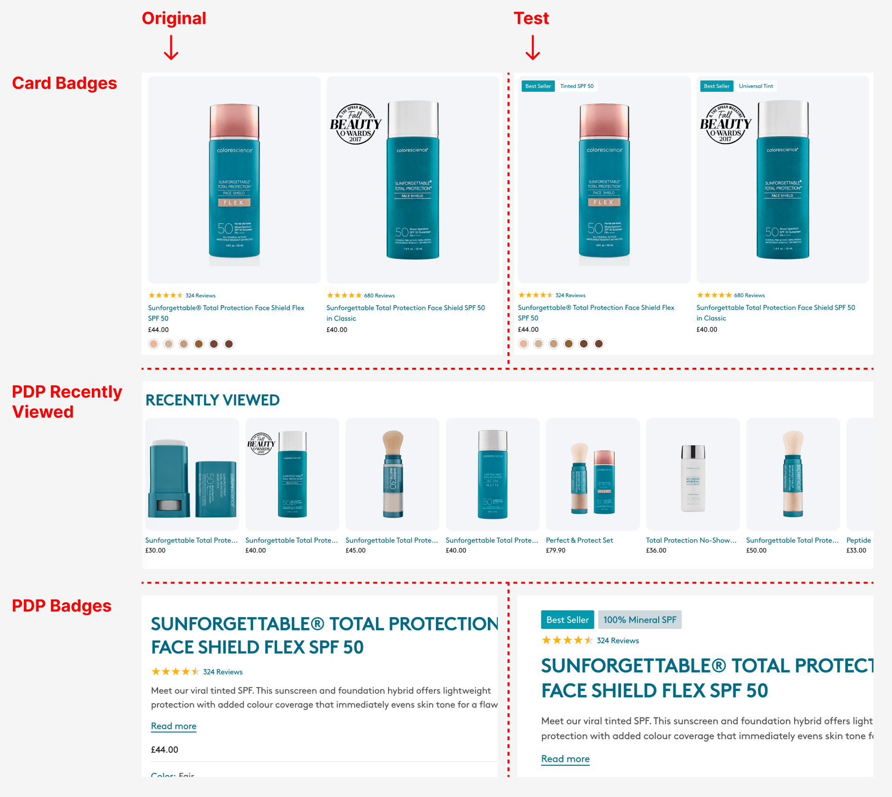
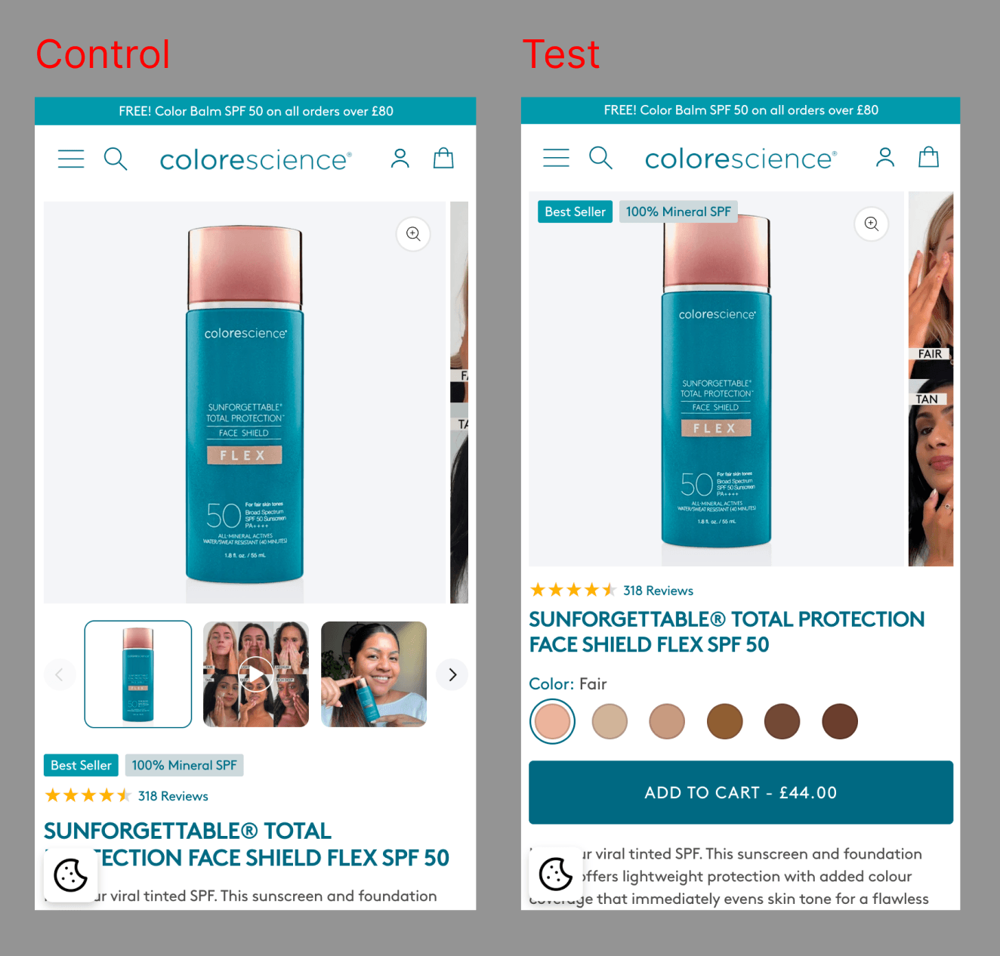
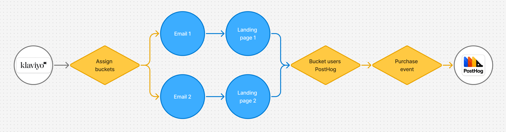
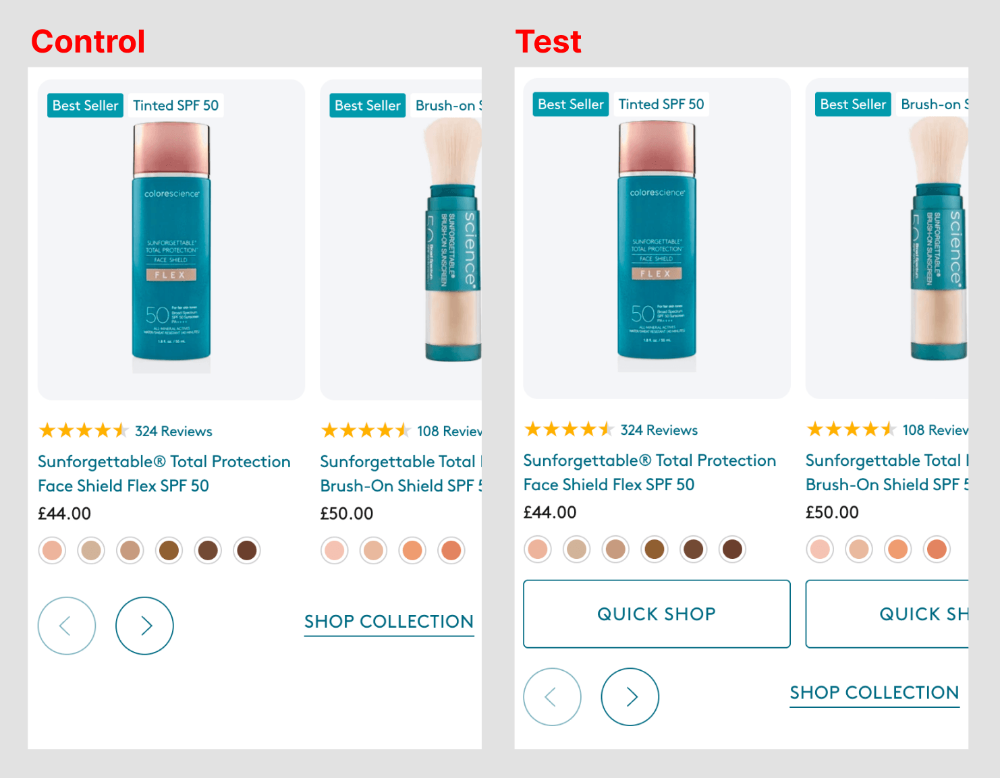
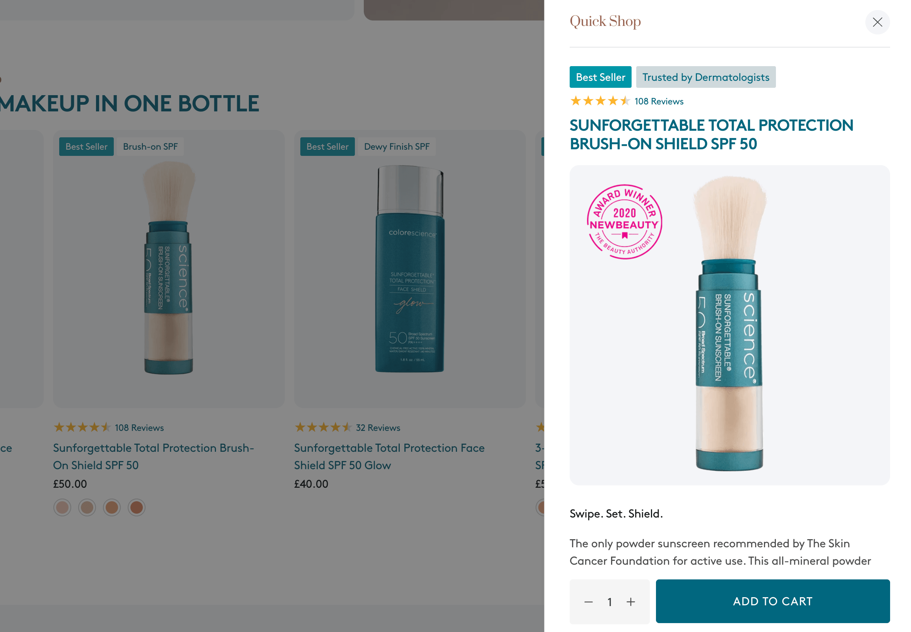

import BeforeAfter from '@/components/ui/BeforeAfter.astro'
import homeBefore from './_assets/cs-before.jpg'
import homeAfter from './_assets/cs-after.jpg'
import pdpBefore from './_assets/cs-pdp-before-mob.jpg'
import pdpAfter from './_assets/cs-pdp-after-mob.jpg'

I run CRO and development for [Colorescience UK](https://colorescienceuk.com/), a premium mineral SPF brand. By August, conversions were up 71% since January, and I was crediting the A/B testing programme I'd been running…

I'd been reading it the way most in-house teams do: this month against last. On a sunscreen brand. From January to August. (Yes, that ~~dumb~~ myopic.)

When I went back over the numbers properly, most of that rise was seasonality and bot traffic, and the tests had been too small to prove their wins. So I rebuilt how we measure and test. The clean numbers showed traffic up 82% year on year with conversion holding, and they pointed to where the next real gain was. Four tests over the following seven weeks took UK conversion to <mark>6.04% by October</mark> - out of season!

Over the last 12 months, CRO work in conjunction with scaling paid ads grew revenue by <mark>£237K year on year</mark>.


***

## Context

Colorescience sells mineral sunscreen direct to consumers. It's premium, 94% of UK sessions are mobile, and it's very seasonal: autumn traffic is around 40% of July's.

In 2025 I rebuilt the store, moving it from an ageing off-the-shelf theme to a custom Dawn build, after research showed that speed and an overloaded mobile product page were the main problems. Mobile product pages went from <mark>5s+ to ~0.5s</mark>, and the site overall is 9.1× faster.

(Really not exaggerating here, it was *crushingly* slow…)

<BeforeAfter
  before={homeBefore}
  after={homeAfter}
  beforeLabel="Before"
  afterLabel="After"
  alt="Colorescience UK homepage after the Dawn rebuild"
/>

<BeforeAfter
  before={pdpBefore}
  after={pdpAfter}
  beforeLabel="Before"
  afterLabel="After"
  alt="Colorescience UK mobile product page after the Dawn rebuild"
  maxWidth="280px"
/>

A ~16% price rise landed in the same weeks, so I don't credit the rebuild with a specific conversion lift. But everything below sits on it.

***

## What I got wrong: the numbers

Three things were driving that +71%, and none of them had anything to do with the site:

- **Seasonality.** In 2024, with no testing at all, conversion rose 79% over the same months.
- **Bots.** From mid-January, a scraper wave hit Direct traffic with non-UK sessions of 2–5 seconds that landed straight on product pages. By April, it made up ~91% of Direct sessions, and the all-traffic purchase rate was 2.20% against 5.16% for UK visitors.
- **Promotions and spikes.** There were three major discount periods over summer, and in January a podcast sent organic traffic to 4.5× December's level.

{/* CHART: conversion by month, 2024 vs 2026 */}

With those stripped out, I compared the same promotion-free days in 2025 and 2026 (12–28 July and 12–23 August), UK only:

- Sessions were up 82%, and purchases were up 78%.
- The purchase rate went from 5.83% to 5.68%, well within each other's 95% intervals. <mark>Conversion held.</mark>

{/* CHART: matched-window sessions, purchases and purchase rate with intervals */}

That's better than it sounds. Most of the growth came from paid channels: Paid Search went from 3.5% to 20.4% of sessions, Meta spend grew significantly, and Meta visitors add to cart at about a third of everyone else's rate. Conversion held anyway, and mobile basket → purchase improved from 35.6% to 38.1%.

## What I got wrong: the tests

From January to August, I'd been running tests on PostHog and shipping variants once they had a 75–85% probability of beating control. When I re-ran them over their full periods, UK only, none could be proven: every 95% interval crossed zero.



The three I shipped did all point upwards: PDP Recently Viewed (+4.0%), Card Badges (+6.8%) and PDP Badges (+5.5%). Combined, they come out at a median of +11%, with a 73% chance of being positive. They most likely helped, but "most likely" wasn't what I'd been reporting.

{/* CHART: every test's lift with its 95% interval, shipped tests marked */}

{/* IMAGE: PDP Badges control vs variant (mobile), the clearest example of an early read */}

There were three reasons:

- **Too little traffic.** The plan targeted 4–8% lifts, but a two-week test here carries about ±16% noise.
- **Early reads.** Mid-test readings ran consistently higher than full-period results. PDP Badges looked like +19.9% before settling at +5.5%. USP variant C was shipped on AOV, a metric chosen after the results came in, even though its conversion was most likely below control.
- **Uneven splits.** The first three tests put up to 54% of visitors into the test arm. A split like that means something in the setup was broken, so those results can't be trusted however they read.

## How I fixed it

I fixed the measurement first. Tests now enrol UK visitors only, at the point they're assigned a variant. Year-on-year comparisons use the same days, with promotion days removed using order data. I reconcile Shopify, GA4 and PostHog against each other rather than trusting any one of them. Add to cart now counts the sticky button as well as the main one, and I applied that back through past data.

Then I fixed the testing. Before launch, each test now gets one primary metric, a ship threshold and a fixed end date. It's read once, after a split check. I rebuilt the test harness so feature flags only load on pages where their test appears, and moved to fewer, bolder tests sized to the traffic we have. I also relabelled Card Badges and PDP Badges as untested features, and recommended reverting USP variant C.

## What clean data showed

With numbers I could trust, the biggest gap in the funnel was <mark>mobile product page → add to cart</mark>: 20.3% on mobile against 29.6% on desktop.

On the best-selling product, a standard iPhone showed the gallery, rating and title on the first screen, with the price and Add to Cart just below. Nearly half of visitors (48%) never scrolled past that first screen, and only 2–5% of them added to cart. Of those who scrolled past Add to Cart, 42% added.

Most of those first-screen exits came from Meta ads: 73% of Meta visitors left there, against 34% of everyone else.

{/* CHART: ATC by scroll depth; first-screen exits, Meta vs other */}

That made it the natural first test, and a clear example of where the clean data led. Instead of a list of ideas to try, it pointed to one step, on one device, driven by one audience. The change followed directly from it: put the price, shades and Add to Cart on the first screen, where most Meta visitors decide whether to stay.

***

## Seven weeks, four tests

- **Weeks 1–2:** a decision-first mobile product page (shipped), alongside an email test of 15% off vs a free gift (gift kept)
- **Weeks 3–5:** Quick Shop on collection pages, all devices (shipped)
- **Weeks 6–7:** a bundle on the mobile product page (not shipped)

Every test had its primary metric and guardrails written down before launch, a fixed end date, one read at the end and a split check before that read. I ship when the primary metric has at least a 90% chance of beating control and no guardrail is clearly worse.

### 1. Decision-first product page (weeks 1–2)

The change: on mobile, the title, price, shade swatches and Add to Cart all sit on the first screen. It reorders existing content across every mobile product page, so it needs no new copy.

I also removed the quantity selector. Quantity can already be changed in the cart drawer, and for a cold audience arriving from a Meta ad, every control before the button is friction. Getting the first purchase mattered more than selling multiples.



Only mobile visitors were enrolled. The flag is checked only on mobile product pages, so desktop visitors, who would never see a difference, can't dilute the result. Add to cart counts both the main and the sticky button.

5,350 UK mobile visitors over two weeks:

- **Add to cart (primary):** 21.47% → 23.10%, <mark>+7.6%, with a 92.4% chance of beating control</mark>
- **Conversion:** 13.08% → 13.80%, +5.5% (78% chance)
- **Average order value:** £59.40 → £58.70, −1.2% (43% chance)
- **Revenue per visitor:** +4.3% (65% chance)

Add to cart cleared the bar, and conversion and revenue point the same way without being proven on their own. Putting the decision on the first screen fixed the largest gap the funnel analysis found, so it shipped.

### 2. 15% off vs a free gift (weeks 1–2)

Marketing relied heavily on discounts and gifts. I was against using price as a lever on a premium brand at all, because it trains customers to wait for the next offer, and no test window captures that. But since offers were going out anyway, it was worth finding out which one costs less.

**Hypothesis:** a 15% discount would convert enough better than a free deluxe sample (on orders over £60) to make more money overall.

**Primary metric: margin per recipient.** That's total margin from an arm's orders divided by the number of people emailed in that arm.

- **Why margin:** conversion, revenue per visitor and AOV all ignore the cost of the offer, so they can point the wrong way.
- **Why per recipient:** PostHog only sees people who click through, and the two emails attract different people. Dividing by everyone emailed keeps the comparison randomised.

Conversion, revenue and AOV per recipient were secondary metrics: they explain *why* the result happened, but none of them decides it. Repeat rate and LTV by arm sit with marketing in Lifetimely.

**How it worked:**



- The Klaviyo list was split randomly into two arms, with the arm saved on each profile.
- Each arm's email linked to its own landing page. The pages were identical apart from the offer, unlisted and set to noindex.
- On load, the page records the arm with `posthog.register({ offer_arm })`, so it's attached to every later event, and applies that arm's code. Each code works once per customer, and the two can't combine.
- In the gift arm, the cart script reads the arm and adds the gift when the cart reaches £60, then removes it if the cart drops below (much harder to get right than it sounds, but too long to cover here).

**Margin without per-order cost data.** If margin depends only on revenue and which offer the order actually used, a few formulas cover it. With *m* as average gross margin at full price (50%), *R* as revenue ex-VAT and shipping, and *G* as the gift's cost (£4):

- **Order used the 15% code:** R × (1 − (1 − m) ÷ 0.85) = 0.412 × R
- **Order included the gift:** m × R − G = 0.50 × R − £4
- **Order used neither:** m × R

The checkout pixel picks the formula from the order itself, not from the user's arm. That way, someone in the 15% arm who buys without the code is correctly given full-price margin:

```js
analytics.subscribe('checkout_completed', (event) => {
  const c = event.data.checkout;
  const codes = (c.discountApplications || [])
    .filter(d => d.type === 'DISCOUNT_CODE')
    .map(d => d.title.toUpperCase());

  const hasPct  = codes.includes('TEST15');
  const hasGift = c.lineItems.some(l => String(l.variant?.id).endsWith(GIFT_VARIANT_ID));

  const R = c.totalPrice.amount - c.totalTax.amount - (c.shippingLine?.price.amount || 0);
  const m = 0.50, G = 4;

  const margin = hasPct ? R * (1 - (1 - m) / 0.85)
                        : m * R - (hasGift ? G : 0);

  posthog.capture('purchase', { revenue: R, margin, pct_used: hasPct, gift_used: hasGift });
});
```

Custom pixels run in a sandbox, so the pixel reads the PostHog ID from its cookie and initialises PostHog with it. Otherwise, purchases wouldn't carry the arm.

40,000 UK recipients, 14 days after the send:

- **Margin per recipient (primary):** £0.45 for the gift vs £0.42 for 15% off, so <mark>the discount made 7.1% less margin</mark> (24% chance it's actually better)
- **Conversion:** 1.80% → 2.00%, +11.1% for the discount (93% chance)
- **Average order value:** £66.20 → £61.40, −7.3% (14% chance)
- **Revenue per recipient:** £1.19 → £1.23, +3.0% (62% chance)

About 60% of gift-arm orders included the gift. Revenue figures include VAT, and margin is calculated ex-VAT.

The discount wins clearly on conversion and slightly on revenue, but it loses on margin. On conversion or revenue alone, marketing would have shipped it. On margin, the gift is the better offer.

### 3. Quick Shop (weeks 3–5)

The change: Quick Shop buttons are always visible on mobile product cards. On desktop, they appear on hover with a short animation to draw attention. Control had hover-only Quick Shop on desktop and none on mobile.



I ran it across all devices to get a big enough sample. 20,000 UK visitors over three weeks:

- **Product view rate, page or drawer (primary):** 46.0% → 47.4%, <mark>+3.0%, with a 97.6% chance of beating control</mark>
- **Products viewed per user:** 2.31 → 2.38, +3.0% (95.1% chance)
- **Quick Shop click rate:** 5.1% → 7.9%, +54.9% (>99.9% chance)
- **Add to cart:** 15.20% → 15.95%, +4.9% (92.8% chance)
- **Conversion:** 9.10% → 9.38%, +3.1% (75.3% chance)
- **Average order value:** £61.20 → £61.55, +0.6% (55.3% chance)
- **Revenue per visitor:** +3.7% (72.3% chance)
- **Cart → purchase:** 59.87% → 58.81%, −1.8% (27.4% chance)

The sample was big enough to confirm the engagement effect, but not the revenue effect. A 75% chance on conversion means roughly a 1 in 4 chance that the real effect is zero or negative.



Two traps came out of this one:

- **Compare arms, not clickers.** People who open Quick Shop were more likely to buy anyway, so comparing clickers with non-clickers exaggerates the effect. The only fair comparison is control against variant.
- **Check for substitution.** If people open the drawer *instead of* the product page, product viewing hasn't increased; they've just taken a different route. I should have checked whether product page views fell by about as much as drawer opens rose. I didn't, and the primary metric can't rule it out.

### 4. Bundle on the product page (weeks 6–7)

I was against this test. Our CMO pushed for it because kit sales from ads were up 180% year on year, and expected bundles to lift AOV and customer lifetime value. But the decision-first page had just won by moving Add to Cart *up*, and a bundle module above the button moves it back down and adds a decision before the visitor can buy. I expected it to hurt.

Control was the decision-first page that had just shipped. 8,000 UK mobile visitors over two weeks:

- **Add to cart (primary):** 23.10% → 22.13%, <mark>−4.2%, with only a 15% chance of beating control</mark>
- **Conversion:** 13.80% → 13.04%, −5.5% (15.9% chance)
- **Average order value:** £58.70 → £59.60, +1.5% (60.6% chance)
- **Revenue per visitor:** −4.1% (30.7% chance)

Average order value ticked up slightly, but the module cost more conversions than the bundle gained, so revenue per visitor fell. The likely cause is the one I expected: it pushed the main button down the page and added a decision before the visitor could buy. It didn't ship.

***

## Where it landed

UK conversion reached <mark>6.04% in October</mark>. That's out of season for a sunscreen brand, when traffic is around 40% of July's. Marketing ran strong campaigns over the same weeks, so not all of it belongs to the tests, but the decision-first page and Quick Shop both moved the funnel steps they were aimed at.

{/* TODO: October 2025 UK conversion on the same basis, for a like-for-like comparison */}

***

## Key Learnings

**Check the denominator before the result.** Seasonality and bots moved this store's conversion rate more than any test did.

**Size tests to the traffic you have.** On a small store, a steady stream of small tests produces confident-looking noise. Fewer, bolder tests with a planned read can actually answer something.

**Break problems down by source.** The biggest product page problem turned out to be mostly one channel.

**Choose the metric that matches the cost.** On conversion or revenue, the discount won. On margin, the gift did. Picking the metric first is what stopped the wrong offer shipping.

**Compare arms, and check where engagement came from.** Clickers aren't a control group, and a new route to the same page isn't more interest.
